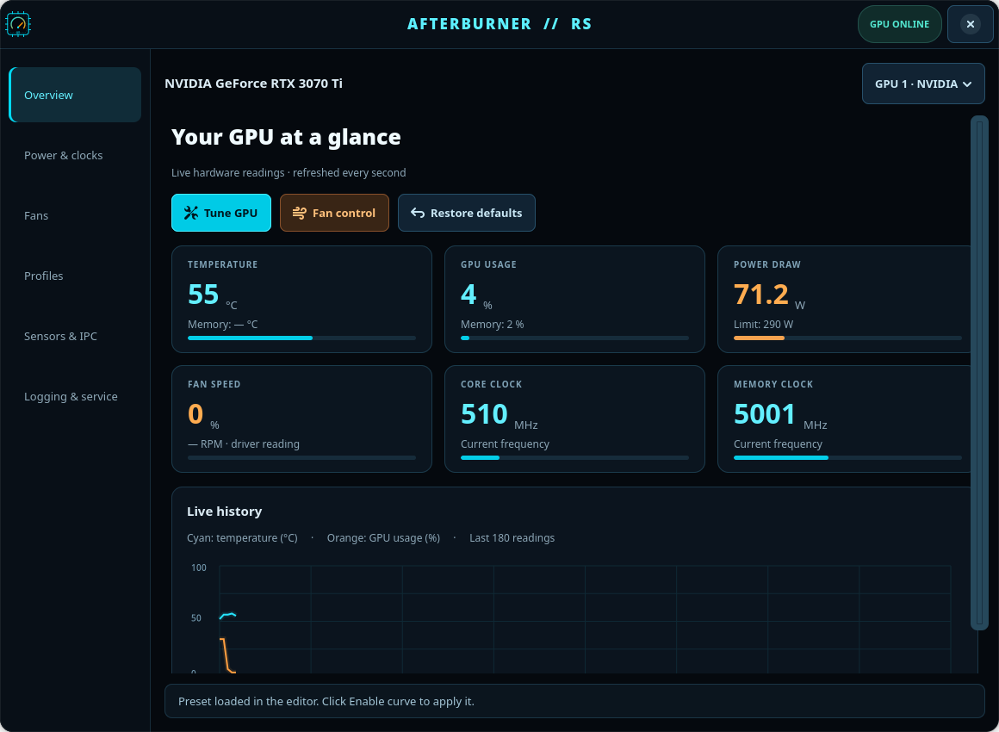
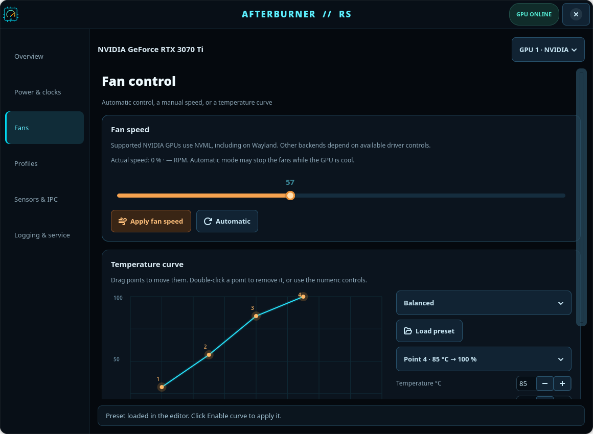

# Afterburner RS

**A native Linux GPU control center written in Rust, with a black-and-neon GTK4 interface.**

Monitor your GPU, adjust supported power and clock settings, control NVIDIA fans on
Wayland, create software fan curves, save profiles, and export sensor readings.
The project also experiments with Afterburner-style MAHM/MACM interoperability.

**Status:** experimental · **Version:** 0.2.0 · **Interface:** English · **License:** GPL-2.0-or-later

> **Not an official MSI product.** This is an independent Linux implementation
> inspired by parts of MSI Afterburner 4.6.6's behavior and interfaces. It is not
> the Windows application running under Wine, and it is not a complete or
> drop-in replacement for MSI Afterburner or RTSS.



## Contents

- [What it can do](#what-it-can-do)
- [What it cannot do](#what-it-cannot-do)
- [Hardware support and validation](#hardware-support-and-validation)
- [Requirements](#requirements)
- [Build and install](#build-and-install)
- [Using the native interface](#using-the-native-interface)
- [Fan control and Wayland](#fan-control-and-wayland)
- [Command-line reference](#command-line-reference)
- [Configuration and profiles](#configuration-and-profiles)
- [CSV logging](#csv-logging)
- [Services and permissions](#services-and-permissions)
- [MAHM and MACM interoperability](#mahm-and-macm-interoperability)
- [Optional legacy web server](#optional-legacy-web-server)
- [Known limitations and safety](#known-limitations-and-safety)
- [Testing](#testing)
- [Troubleshooting](#troubleshooting)
- [Project structure and implementation](#project-structure-and-implementation)
- [Uninstalling](#uninstalling)
- [Contributing and publishing](#contributing-and-publishing)
- [License and acknowledgements](#license-and-acknowledgements)

## What it can do

| Area | Implemented functionality | Important qualification |
| --- | --- | --- |
| Native desktop UI | GTK4 window, sidebar, buttons, sliders, numeric inputs, confirmation dialogs, sensor table | No browser, WebView, or embedded terminal |
| GPU discovery | Enumerate supported PCI display devices with DRM entries; display NVIDIA names where available | Devices without a DRM card entry are currently skipped |
| Live monitoring | Core/memory temperature, fan percentage/RPM, core/memory clocks, GPU/memory utilization, power draw and power limit | Only readings exposed by the backend appear; missing values are not invented |
| History | Two live graph series for temperature and GPU usage, up to 180 samples per GPU | In-memory history; not a persistent graph database |
| Power tuning | Request an absolute power limit, with the GTK slider using driver-reported bounds | Driver, board, permissions, and firmware must permit the write |
| NVIDIA clock locks | Request minimum/maximum core and memory clock ranges using `nvidia-smi` | Not supported on every NVIDIA GPU; this is not a clock offset |
| Clock offsets | Request core/memory offsets through NVIDIA NV-CONTROL or an available CLI interface; experimental AMD sysfs path | NVIDIA offsets may need Xorg/Coolbits; AMD control is unvalidated |
| NVIDIA manual fans | Set the fans belonging to the selected PCI GPU using NVML | Requires the relevant NVML functions and sufficient permissions |
| Automatic fans | Return supported NVIDIA fans to firmware/driver control | Zero-RPM behavior is decided by the driver, not emulated by the GUI |
| Software fan curve | Edit, drag, add, remove, validate, save, enable, and disable curve points | A running daemon applies one configured GPU curve at a time |
| Curve presets | Balanced, Quiet, and Aggressive starting points | Presets are examples, not hardware-specific safety recommendations |
| Profiles | Nine named GTK slots with save/load and overwrite confirmation | Saves the controls' requested values, not a complete hardware-state snapshot |
| Reset | Request default power, reset clock locks/offsets where implemented, disable the curve, and restore automatic fans | A request can partially fail; always inspect feedback and readings |
| CSV | Append complete multi-GPU polls from the background daemon | No automatic rotation or retention policy |
| Background monitoring | systemd service for MAHM publication, logging, and enabled curves | Runs as the selected desktop user |
| Fan permission bridge | Small root service with a restricted local Unix-socket protocol | NVIDIA fan operations only; not a generic privileged shell |
| MAHM | Publish/read an SDK-derived v2-style monitoring layout in `/dev/shm` | Validated with the included Linux reader, not every third-party consumer |
| MACM | Experimental reading of control-memory structures and basic command dispatch | Incomplete; see the interoperability section before using it |
| CLI/TUI | Inventory, information, monitoring, settings, reset, profiles, shared-memory dumps | Legacy commands have limitations documented below |

## What it cannot do

The following are **not implemented**, even if the Windows application supports them:

- RTSS injection, an in-game overlay, FPS limiting, or game hooking.
- An integrated FPS/frame-time collector. Constants in the source are not a working collector.
- Video recording, desktop/game capture, or a screenshot hotkey. The UI test's
  own-window PNG export is a testing facility, not a recording feature.
- OC Scanner, automated stability testing, stress testing, or a safe-overclock wizard.
- Core-voltage adjustment or an editable voltage/frequency curve.
- BIOS flashing, firmware modification, raw GPU-register/MMIO/I2C/MSR access,
  or a Linux equivalent of the proprietary RTCore Windows kernel driver.
- Windows skin/plugin loading, Logitech LCD output, or full Windows profile import.
- Global keyboard shortcuts, tray integration, automatic per-game profiles,
  or automatic startup application of overclocking profiles.
- Intel fan/power/overclock controls in the current backend.
- Fully validated AMD tuning, full MACM emulation, or universal hardware support.
- Remote administration, a secured network API, or a production-grade multi-user service.
- An independent thermal failsafe/watchdog or guaranteed recovery after a crash.
- A complete feature-for-feature Linux port of the original proprietary application.

## Hardware support and validation

### Backend matrix

| Capability | NVIDIA | AMD / `amdgpu` | Intel / `i915` / `xe` |
| --- | --- | --- | --- |
| Monitoring | `nvidia-smi`; available driver fields | DRM/sysfs/hwmon | Limited hwmon readings |
| Manual fan control | NVML; NV-CONTROL fallback for older drivers | Experimental PWM writes | Not implemented |
| Automatic fan control | NVML default-fan API | Backend contains an automatic-PWM write, but capability/UI support is incomplete | Not implemented |
| Power limit | `nvidia-smi` | Experimental power-cap/sysfs writes | Not implemented |
| Core/memory clock locks | `nvidia-smi`, device-dependent | Not implemented | Not implemented |
| Clock offsets | NV-CONTROL / driver-dependent CLI | Experimental OverDrive table handling | Not implemented |
| Voltage / V/F editing | Not implemented | Not implemented as a supported feature | Not implemented |
| Hardware validation in this project | One configuration, described below | Not validated | Not validated |

Some capability flags are currently optimistic. An enabled control is **not** a
guarantee that the hardware accepts it. Read the operation feedback and verify the
result independently, especially on a GPU that has not been tested.

### Actually tested

The development machine used an **NVIDIA GeForce RTX 3070 Ti**, NVIDIA driver
**615.78.08**, and **GNOME on Wayland**, on x86-64 Linux.

Observed validation includes:

- PCI/DRM discovery and NVIDIA display-name lookup.
- Live temperature, utilization, clock, fan-percentage, and power readings.
- Reporting the board's power-limit bounds: 100–319 W, with a 290 W default.
  These are **this board's values**, not defaults for all GPUs.
- Setting both physical fans to a 60% target through the NVML permission bridge.
  Driver readback reached **60% on both fans**, and automatic control was restored.
- MAHM publication with a 1,324-byte monitoring entry and reading it through
  `examples/mahm-reader.py`.
- Native rendering, navigation, harmless editor controls, and normal window close
  across all six GTK pages.
- Daemon CSV output with live sensor data.

Memory temperature, fan RPM, and other fields may be unavailable even on that
configuration. Other NVIDIA models/driver versions, AMD, Intel, other desktop
environments, distributions, and CPU architectures require additional testing.

## Requirements

### Build requirements

- Linux, a C linker/toolchain, and a recent stable Rust/Cargo toolchain.
  Development builds used Rust/Cargo 1.99.1; there is no tested minimum-version policy yet.
- Development/linker files for **GTK4**, **GLib**, **GObject**, **GIO**, and **Cairo**.
- Git if you are cloning or contributing to the repository.

There are **no third-party Rust crates**. `cargo build --offline` does not download
Rust dependencies, but it still needs the compiler and system libraries already installed.
This is **not** a statically linked or system-dependency-free application: even
CLI commands use the same GTK-linked executable.

Typical native development packages, depending on your distribution:

| Distribution family | Common packages |
| --- | --- |
| Debian / Ubuntu | `build-essential`, `pkg-config`, `libgtk-4-dev`, `libglib2.0-dev`, `libcairo2-dev` |
| Fedora | `gcc`, `pkgconf-pkg-config`, `gtk4-devel`, `glib2-devel`, `cairo-devel` |
| Arch Linux | `base-devel`, `rust`, `gtk4`, `glib2`, `cairo` |

Package names and versions vary; the table is guidance, not a tested distribution matrix.

### Runtime requirements

- A working GPU driver exposing the relevant PCI/DRM/sysfs interfaces.
- For NVIDIA: the driver's `nvidia-smi` and `libnvidia-ml.so.1`.
- `nvidia-settings` only for the optional NV-CONTROL offset/older-fan fallback.
- A graphical GTK-capable Wayland or X11 session for the native UI.
- systemd, Bash, standard installation utilities, and administrative access for
  the provided system installer.
- `pkexec` and a working desktop PolicyKit agent for the GUI's optional
  authorization of protected power/clock/reset requests.
- `xdg-open` for the **Open CSV** and **Settings folder** buttons.
- `desktop-file-utils` for menu-database updates; Python 3 for the example reader.

There is no Wine, Windows installation, proprietary installer payload, Electron,
Node.js, web browser, or Rust package registry requirement for normal native use.

## Build and install

Run the following from the Rust project directory, which contains `Cargo.toml`:

```bash
cargo build --release --locked --offline
cargo test --locked --offline
```

You can open the uninstalled UI for monitoring:

```bash
./target/release/afterburner-rs gui
```

However, the menu launcher, the privileged fan bridge, background curves/logging,
and the GUI's installed-binary authorization path require the system installation:

```bash
sudo bash extra/install-native.sh "$USER"
afterburner-rs gui
```

Pass the **desktop user's login name**, not `root`. The installer does not
download packages, save a password, install GPU drivers, change GDM/Coolbits,
or switch your desktop from Wayland to Xorg.

### What the installer changes

- Installs the executable at `/usr/local/bin/afterburner-rs`.
- Generates systemd units from the `.service.in` templates for your user/UID/group.
- Enables and starts `afterburner-rs.service` and `afterburner-rs-fan.service`.
- Installs **Afterburner RS** in the system and per-user application menus.
- Installs the original project SVG icon in the system and per-user icon themes.
- Refreshes application databases when `update-desktop-database` is available.
- Stops older service instances before replacing the executable.
- Can fix ownership of the two known MAHM files left by an earlier root daemon.

The binary and installation prefix are currently fixed; there is no `--prefix`
option or officially maintained Flatpak/AppImage/distribution package.

The current installer configures **one desktop user** and uses that user's
`~/.config`. A custom `XDG_CONFIG_HOME` requires a matching systemd override.
Installing for another user replaces the service configuration; it is not a
multi-user installation manager.

## Using the native interface

Launch **Afterburner RS** from the application menu or run:

```bash
afterburner-rs gui
```

The maintained GTK interface is in **English**. Its controls are actual GTK
widgets; Cairo only draws the two charts. GPU polling and external commands run
on a worker thread instead of blocking the GTK event loop.

The GPU selector is one-based for display: **GPU 1 in the GUI corresponds to
`--gpu 0` in the CLI**. Discovery is performed at startup; hot-plug refresh is
not implemented.

### Overview

Six cards show temperature, GPU usage, power draw, fan speed, core clock, and
memory clock. Secondary text shows available memory-temperature/utilization,
power-limit, and fan-RPM readings. A dash means **unavailable**, not zero.

The history graph keeps up to 180 in-memory samples per GPU:

- Cyan: core temperature in degrees Celsius.
- Orange: GPU utilization in percent.

The worker targets approximately one update per second; driver/process latency
means 180 samples are not a guaranteed exact three-minute interval. History is
lost when the application exits.

### Power & clocks

- **Apply power limit** submits the slider value in watts.
- **Apply offsets** requests the core/memory offset fields in MHz.
- **Apply clock ranges** uses only the checked core/memory min/max ranges.
- **Request authorization for power and clocks** uses a system authorization
  dialog and the installed root-owned CLI executable. It does not run GTK as root.
- **Restore driver defaults** asks for confirmation before requesting a reset.

Clock-input bounds are UI/backend bounds, **not** proof of a safe or supported
overclock. The locked-clock path is currently NVIDIA-specific. Unsupported or
permission-denied operations may fail, and a multi-part request may partially apply.

### Fans



The manual slider currently covers **30–100%**. Clicking **Apply fan speed**
disables the saved software curve and submits the manual target. **Automatic**
disables the curve and asks the backend to return control to the driver.

The curve editor provides:

- Balanced, Quiet, and Aggressive presets.
- 2–32 validated points, each with a distinct temperature from 30–110 °C.
- 0–100% duty values, subject to backend/board limits.
- Drag-to-move, double-click-to-remove, numeric editing, and add/remove buttons.
- Explicit **Enable curve** and **Disable curve** actions.

Editing points or loading a preset only changes the draft. Enabling saves the
curve and selected GPU index; the **running daemon** applies it on its next poll.
The current engine uses linear interpolation and a stepped change toward the
target rather than instantly jumping between every requested speed.

On the NVIDIA NVML path, a nonzero target below the board's minimum is clamped;
zero means **return to automatic control**, not a command to force the fan to stop.
The minimum may fall back to 30% if the driver cannot report a usable range.
Do not assume those NVIDIA semantics apply to the experimental AMD PWM path.

### Profiles

- Nine shared profile slots, with an optional name for the next save.
- Saves the current control values: supported offsets/power, requested fan mode,
  curve draft/state, and enabled clock-lock ranges.
- Loading applies the stored values to the **currently selected GPU**.
- Existing slots require overwrite confirmation.

Profiles are not bound to a GPU UUID, do not capture every hardware setting, and
are not automatically loaded at login or when a game starts. Review the values
before reusing a profile on another board.

The legacy CLI profile commands use the same files but are **not feature-parity
equivalent**: `profile save` does not reconstruct a complete tuning state, and
`profile load` targets the first discovered GPU and does not restore every
GTK-specific lock/curve setting. Prefer the GTK profile workflow for this release.

### Sensors & IPC

Shows actual published MAHM sources as a native table: name, value, unit, GPU,
and source ID. A second status area reports whether a MACM image/client is present.
This page needs the daemon for MAHM publication; the Overview reads the driver
independently and can work without it.

### Logging & service

Choose whether to log sensors, specify an **absolute CSV path**, set the daemon
poll period, and save the settings. Buttons start, restart, or stop the monitoring
service. System service management can require desktop authorization.

CSV/polling settings are hot-reloaded. Changing the optional legacy web-server
setting requires restarting the monitoring service. This screen does not turn
that web server into a dependency of the native UI.

## Fan control and Wayland

Supported NVIDIA fan control uses these dynamically loaded NVML interfaces:

- `nvmlDeviceGetHandleByPciBusId_v2`
- `nvmlDeviceGetNumFans`
- `nvmlDeviceGetMinMaxFanSpeed`
- `nvmlDeviceSetFanSpeed_v2`
- `nvmlDeviceSetDefaultFanSpeed_v2`

Fan operations target the selected **PCI device**, enumerate its fans, and apply
the requested speed to those fans. The UI does not currently provide independent
per-fan sliders. Readback can take several seconds to reach the target because
the driver ramps the physical fans.

NVML fan writes often require root. The normal-user backend first attempts the
operation and, on an insufficient-permissions result, requests it through the
installed fan bridge. **This path does not require Xorg or Coolbits.**

Older GPUs/drivers without the required NVML interfaces may fall back to
`nvidia-settings`/NV-CONTROL. That fallback and NVIDIA clock **offsets** may have
different Xorg, Coolbits, display-access, and driver requirements. Wayland fan
support must not be confused with universal Wayland overclocking support.

### Closing and persistence

- Closing the GUI normally requests automatic mode for the most recently
  tracked manually controlled GPU, then waits for the worker to finish.
- A saved, enabled software curve belongs to the monitoring daemon and may
  continue with the GUI closed or after the daemon starts at boot.
- Stopping the fan bridge normally attempts automatic mode on devices it touched.
- None of this is a guaranteed crash-recovery system. See the safety limitations.

## Command-line reference

```text
afterburner-rs gui [--smoke-test DIRECTORY]
afterburner-rs list
afterburner-rs info [--gpu INDEX]
afterburner-rs monitor [--gpu INDEX] [--period MS] [--iterations COUNT] [--csv PATH]
afterburner-rs tui [--frames COUNT] [--plain]
afterburner-rs set --gpu INDEX [OPTIONS]
afterburner-rs reset --gpu INDEX
afterburner-rs fan-curve TEMP:PERCENT,TEMP:PERCENT,...
afterburner-rs profile list|save N|load N|show N
afterburner-rs daemon [--period MS]
afterburner-rs mahm-dump
afterburner-rs macm-dump
```

`fan-service UID` is an internal system-service entry point, not a desktop command.

### Read-only examples

```bash
afterburner-rs list
afterburner-rs info --gpu 0
afterburner-rs monitor --gpu 0 --period 1000 --iterations 10
afterburner-rs tui --frames 5 --plain
afterburner-rs mahm-dump
python3 examples/mahm-reader.py
```

### Settings options

| Option | Meaning |
| --- | --- |
| `--gpu INDEX` | Zero-based discovered GPU index; always specify it for writes |
| `--core-offset MHZ` | Requested core offset |
| `--mem-offset MHZ` | Requested memory offset |
| `--lock-gpu-clocks MIN,MAX` | Requested NVIDIA core-clock range |
| `--lock-memory-clocks MIN,MAX` | Requested NVIDIA memory-clock range |
| `--power WATTS` | Absolute power limit |
| `--power-pct PERCENT` | Power limit relative to reported default, with a fallback if unavailable |
| `--fan PERCENT` | Manual fan request |
| `--fan-auto` | Return fan control to the driver |

For example, after installing the permission bridge:

```bash
# These change fan control. Use only on supported hardware.
afterburner-rs set --gpu 0 --fan 60
afterburner-rs set --gpu 0 --fan-auto
```

Other protected writes can require `sudo` from a terminal or the GTK authorization
checkbox. Do not run `sudo afterburner-rs gui`.

**Important:** legacy write commands without an explicit `--gpu` can operate on
all discovered GPUs. Some CLI/API paths can print a completion message or return
success even when notes report a rejected operation. Check the notes and readings;
do not treat an exit status alone as hardware confirmation.

## Configuration and profiles

By default:

```text
~/.config/afterburner-rs/
├── MSIAfterburner.cfg
├── hardware-log.csv       # only if logging is enabled at this path
└── Profiles/
    ├── Profile1.cfg
    ├── ...
    └── Profile9.cfg
```

The executable respects `XDG_CONFIG_HOME`; the installer explicitly configures the
daemon to use the chosen user's `~/.config` unless you override its unit.

Example settings, with tuning and the legacy web server disabled:

```ini
[Settings]
HwPollPeriod = 1000
EnableLog = 0
LogPath = /absolute/path/to/hardware-log.csv
SoftwareFanCurveEnabled = 0
SoftwareFanCurveGpu = 0
SoftwareFanCurve = 40:30,55:55,70:85,85:100
EnableServer = 0
ServerPort = 7939
```

| Key | Effective behavior |
| --- | --- |
| `HwPollPeriod` | Daemon poll interval; hot-reloaded and clamped to 100–10,000 ms |
| `EnableLog` | `1` enables daemon CSV appending; `0` disables it |
| `LogPath` | CSV destination; the parent directory must exist and be writable |
| `SoftwareFanCurveEnabled` | Whether the daemon should actively apply the saved curve |
| `SoftwareFanCurveGpu` | Zero-based GPU index for the one active daemon curve |
| `SoftwareFanCurve` | Comma-separated `temperature:duty` points |
| `EnableServer` | Optional legacy HTTP server; default off; restart required |
| `ServerPort` | Legacy loopback port, default 7939; restart required |

The INI parser accepts ordinary decimal settings and Afterburner-style hexadecimal
integer values such as `00000003h`. Similar key names do **not** imply complete
Windows configuration compatibility. Unknown or historical keys may have no effect.

Prefer the validated GTK editor for fan curves. Legacy CLI/API curve input does
not apply the same strict validation to every path.

## CSV logging

The daemon appends one complete row per poll, with columns for every discovered GPU:

```csv
time,gpu0_temperature_c,gpu0_fan_pct,gpu0_core_mhz,gpu0_memory_mhz,gpu0_usage_pct,gpu0_power_w
1700000000,50.00,40.00,1200.00,5001.00,18.00,55.20
```

The row above is an **illustrative format example**, not benchmark data.
`time` is Unix time in seconds. Unavailable readings are empty fields. A header
is written when the destination file is empty; existing logs are appended, not
replaced. Reusing a log after changing the GPU count can produce a schema mismatch.

There is no built-in rotation, compression, maximum size, or per-game tagging.
Manage long-running logs yourself and check file permissions/free space.

The older `monitor --csv` command is different: it stores a finite history and
writes it at normal command completion. For a one-GPU export, use a finite run:

```bash
afterburner-rs monitor --gpu 0 --period 1000 --iterations 30 --csv ./sample.csv
```

It is not a streaming logger, does not guarantee a flush when interrupted, and its
multi-GPU history layout needs work. Prefer **daemon logging** for continuous or
multi-GPU capture.

## Services and permissions

| Component | Identity | Responsibility |
| --- | --- | --- |
| GTK GUI | Desktop user | Native controls, graphs, profiles, settings, worker coordination |
| Monitoring daemon | Configured desktop user | Sampling, MAHM, CSV, one software fan curve, experimental MACM |
| Fan bridge | root | Restricted NVML fan writes for the configured UID |
| Optional authorized CLI | root after PolicyKit approval | A specific user-requested power/clock/reset operation |

The fan bridge listens at:

```text
/run/afterburner-rs-fan/control.sock
```

It checks the connecting process's UID with `SO_PEERCRED`, accepts root or the
configured desktop UID, validates the PCI-address shape and 0–100/`auto` request,
and exposes fan operations only. Socket permissions are `0660` inside a
systemd-created runtime directory. The unit applies several systemd restrictions.

Installing it grants the configured user privileged **fan-control access** without
a password dialog for every slider change. It does not grant general sudo access.
This is still privileged, experimental code and has **not received an independent
security audit**. Inspect it before installation; hardening options are not a
security guarantee.

Useful service commands:

```bash
systemctl status afterburner-rs.service afterburner-rs-fan.service
journalctl -u afterburner-rs.service -u afterburner-rs-fan.service -b
sudo systemctl restart afterburner-rs.service
```

Do not run a second daemon that competes for the same shared-memory files. Avoid
multiple fan/overclock tools controlling the same GPU simultaneously.

## MAHM and MACM interoperability

### MAHM monitoring: implemented, with limited validation

The daemon writes these regular tmpfs files:

```text
/dev/shm/MAHMSharedMemory
/dev/shm/Access_MAHMSharedMemory
```

The layout is derived from the monitoring SDK shipped with the analyzed release:
version `0x00020000`, 260-byte string fields, and 1,324-byte monitoring entries.
Each entry contains names/units, a floating-point value, limits, flags, GPU index,
and source ID. The unavailable-value sentinel is `f32::MAX`.

Published sources include GPU/memory temperature, fan percentage/RPM, core/memory
clocks, GPU/memory utilization, voltage where available, power draw, and power limit.
Not all backends can populate every source.

The included Python reader validates the Linux layout without requiring Rust:

```bash
python3 examples/mahm-reader.py
```

These are **Linux files**, not Win32 named mappings or synchronization primitives.
Windows clients do not automatically work on Linux. This is also not a tested
MangoHUD or RTSS integration, and there is no promise of compatibility with every
SDK revision or third-party client.

### MACM control: experimental and incomplete

The daemon can inspect a client-supplied `/dev/shm/MACMSharedMemory` image, handle
basic `INIT`/`FLUSH`-style requests, apply a subset of fields to the first GPU, and
clear the command. The GUI exposes status and `macm-dump` can inspect the image.

This is **not complete MACM server emulation**:

- Initialization does not populate a full capability/control response image.
- Multi-GPU/master-GPU semantics are incomplete.
- V/F refresh/editing is not implemented.
- `FLUSH_WITHOUT_APPLYING` is not safely distinct from applying in the current
  request decoder. Do **not** use it as a non-mutating probe.
- Parser/layout compatibility needs additional tests against real client images.

Do not expose control-memory input to untrusted programs. Shared-memory files
are not an authenticated control channel; the root fan bridge's peer checks do
not make every upstream IPC path safe for an untrusted multi-user machine.

## Optional legacy web server

An earlier browser dashboard remains in `src/assets/gui.html`, with a small
loopback HTTP implementation in `src/api.rs`. It is **not used by the native UI**
and is disabled by default. The maintained GTK UI is English; the legacy browser
prototype is not maintained to the same language or feature standard.

If deliberately enabled, it binds to `127.0.0.1`, normally port 7939. Routes include:

| Method | Route | Purpose |
| --- | --- | --- |
| GET | `/api/sample` | Latest daemon sample/capability data |
| GET | `/api/profiles` | List profile slots |
| GET | `/api/mahm` | Published MAHM entries |
| POST | `/api/set`, `/api/reset` | Submit settings/reset requests |
| POST | `/api/curve`, `/api/curve-off` | Change the software curve |
| POST | `/api/profile/save`, `/api/profile/load` | Save/load profile data |
| POST | `/api/log` | Change logging settings |

There is no full JSON/HTTP framework, authentication, comprehensive request
validation, origin/CSRF protection, or TLS. Requests are read through a small
fixed buffer and some responses report acceptance rather than hardware success.
**Keep it disabled unless you understand these limitations. Never expose it
through a reverse proxy or to the Internet.**

## Known limitations and safety

1. **Use at your own risk.** Fan and overclock settings can cause overheating,
   instability, lost work, or hardware damage. No preset is guaranteed safe.
2. **No independent failsafe.** Driver bounds are not a thermal watchdog, stability
   test, or guarantee that the cooling target is adequate.
3. **Recovery is best-effort.** Normal GUI shutdown tracks only the most recent
   manually controlled GPU. Multi-GPU sessions, crashes, forced termination,
   helper failures, and direct CLI use do not guarantee automatic fan restoration.
4. **Persistent curves are active settings.** An enabled daemon curve can run
   after closing the UI and when the enabled service starts at boot. Disable it
   and request automatic fan control when you no longer want it.
5. **One curve, shared slots.** There is one configured daemon curve target and
   nine shared GUI profile slots, not separate per-GPU profile databases.
6. **GPU indices are not permanent identities.** Discovery order may change.
   Review `list`, the selector, and `SoftwareFanCurveGpu` after hardware changes.
7. **AMD writes are experimental.** OverDrive parsing, PWM capability flags, and
   write-error reporting need hardware validation. Do not rely on them for cooling.
8. **Intel is monitoring-only here.** Missing controls are an implementation
   limitation, not a claim that all Intel hardware is inherently uncontrollable.
9. **Partial operations are possible.** Power, offsets, locks, and reset requests
   can have different permission/support outcomes within one operation.
10. **IPC and legacy tooling need work.** See the MACM, web API, legacy CSV,
    profile-parity, and error-reporting caveats above.
11. **No full Windows equivalence.** Similar filenames, keys, and source IDs do
    not provide Windows plugins, RTSS, a scanner, or complete binary compatibility.

Use the GUI's **Automatic** button or explicitly request automatic mode for each
affected GPU when recovering from manual fan experiments. Verify with your
driver's monitoring tools. If uncertain, stop tuning and follow your hardware
vendor's recovery guidance rather than trying increasingly aggressive settings.

## Testing

Pure Rust tests require the linked system libraries but do not need to initialize GTK:

```bash
cargo test --locked --offline
```

They cover curve validation/coordinate transforms, decimal/hex configuration
parsing, complete append-only multi-GPU CSV rows, bounded fan-bridge commands,
and separated CLI arguments for authorized requests. This is a small regression
suite, **not** comprehensive GPU, ABI, security, or hardware-safety certification.

For the native GUI smoke test, use a working graphical session:

```bash
./target/release/afterburner-rs gui --smoke-test ./ui-smoke
```

The smoke test visits all six pages, exercises harmless native editor controls,
checks slider preservation during polling, counts real GTK widget types, excludes
terminal/WebView widgets, saves PNGs of **only its own window**, and requests a
normal window close. It reads live hardware but does not intentionally submit
tuning writes. It writes `report.txt`; look for `GTK_SMOKE_OK` rather than relying
on the process exit status alone. A display-less CI runner needs a suitable
graphical test environment.

The README screenshots come from that native-widget capture path. They are not
HTML mockups. A slider shown in an editor is a draft, not proof it was applied.

## Troubleshooting

| Symptom | Check or explanation |
| --- | --- |
| Linker cannot find `gtk-4`, `gio-2.0`, or `cairo` | Install the corresponding development libraries, not only the runtime application |
| GUI cannot open a display | Run it as the logged-in desktop user in a Wayland/X11 session; do not use `sudo gui` |
| No GPU appears | Verify the kernel/vendor driver and DRM card entries; current discovery skips devices without a card entry |
| NVIDIA readings are absent | Check `nvidia-smi` and driver availability; fields vary between driver versions |
| Fan operation says insufficient permissions/service unavailable | Check `afterburner-rs-fan.service`, the configured UID, and Unix-socket access; reinstall for the correct desktop user |
| Fans remain at 0% in automatic mode | Zero-RPM idle mode can be normal; confirm temperatures and the board's fan policy |
| Actual fan speed lags behind the slider target | The driver can ramp over several seconds; an unapplied draft slider does not change hardware |
| Fans do not stop when the slider is lowered | The manual UI has a 30% floor; firmware minima are respected; use Automatic for driver-managed idle stop |
| Offset fails on Wayland | NVML fan support does not imply offset support; offsets may need a supported NV-CONTROL/Xorg setup or may be unavailable |
| Power/clock request is rejected | Check board limits and permissions; use the explicit authorization option if appropriate |
| Curve is saved but has no effect | Ensure the daemon is running, the target index is correct, and its settings directory matches the GUI's |
| CSV is not created | Enable logging, use an absolute writable path with an existing parent directory, and inspect the daemon journal |
| MAHM data is missing/stale | Check the monitoring service and file permissions; do not run competing root/user daemons |
| `MACM` says no client | A status message, not proof the GPU is missing; no external MACM client image is present |
| Menu entry is missing | Check the installed `.desktop` file and executable; desktop environments may cache application listings |

For an issue report, include the OS/kernel, GPU model, driver version, Rust
version, backend, exact action, relevant operation feedback, and redacted service
logs. Do not publish passwords, tokens, machine identifiers, private profile
names, or unreviewed screenshots of your settings paths.

## Project structure and implementation

```text
afterburner-rs/
├── Cargo.toml / Cargo.lock       # no external Rust crates
├── build.rs                     # links system GTK4/GLib/GObject/GIO/Cairo
├── LICENSE
├── docs/screenshots/             # native UI screenshots used by this README
├── src/
│   ├── main.rs                  # CLI and monitoring daemon
│   ├── gui.rs                   # native English GTK interface
│   ├── gui/ffi.rs               # small hand-written GTK/GObject/Cairo ABI surface
│   ├── gui/worker.rs            # off-main-thread sampling and control requests
│   ├── gpu.rs                   # PCI/DRM discovery and Afterburner-style identifiers
│   ├── drivers/
│   │   ├── nvidia.rs            # NVIDIA monitoring, power/clocks, fan dispatch
│   │   ├── nvfan.rs             # dynamically loaded NVML fan operations
│   │   ├── amd.rs               # experimental amdgpu/sysfs backend
│   │   └── intel.rs             # limited read-only Intel hwmon backend
│   ├── fan_service.rs           # UID-checked privileged fan bridge
│   ├── fancurve.rs              # software curve interpolation/ramping
│   ├── config.rs                # INI settings and profile files
│   ├── monitor.rs               # history, MAHM sources, CSV
│   ├── mahm.rs / macm.rs        # monitoring/control-memory structures
│   ├── tui.rs                  # separate terminal interface
│   ├── api.rs                  # optional legacy loopback web prototype
│   └── assets/                 # GTK CSS, project icon, legacy HTML
├── examples/mahm-reader.py
└── extra/
    ├── install-native.sh
    ├── afterburner-rs.service.in
    ├── afterburner-rs-fan.service.in
    └── *.desktop
```

Development was guided by inspection of the supplied MSI Afterburner 4.6.6
installer/distribution, its hardware-abstraction interfaces, and the shipped SDK's
monitoring/control structures. The Linux code routes functionality through Linux
drivers and native GTK libraries rather than loading Windows DLLs or kernel drivers.

The project builds without the proprietary installer, extracted DLLs, original
skins, firmware, or bundled promotional software. The distribution's presence of
RTSS, OC Scanner, plugins, or LCD features does **not** mean those are implemented
here. This project does not claim an audited clean-room process or vendor endorsement.

## Uninstalling

First disable curves and restore automatic fans for affected GPUs. Then stop and
disable both installed services:

```bash
sudo systemctl disable --now afterburner-rs.service afterburner-rs-fan.service
```

Remove only the installed project files:

```bash
sudo rm -f /usr/local/bin/afterburner-rs
sudo rm -f /etc/systemd/system/afterburner-rs.service
sudo rm -f /etc/systemd/system/afterburner-rs-fan.service
sudo rm -f /usr/share/applications/afterburner-rs-gui.desktop
sudo rm -f /usr/share/icons/hicolor/scalable/apps/afterburner-rs.svg
rm -f "$HOME/.local/share/applications/afterburner-rs-gui.desktop"
rm -f "$HOME/.local/share/icons/hicolor/scalable/apps/afterburner-rs.svg"
sudo systemctl daemon-reload
```

Older installations may also have a separately installed
`afterburner-rs-monitor.desktop` terminal launcher. Remove that specific launcher
if present. User settings, profiles, logs, and the source checkout are deliberately
not deleted by the commands above. Update your desktop databases if necessary.

## Contributing and publishing

Useful contributions include real AMD/Intel validation, conservative capability
detection, reliable write-result propagation, MACM conformance tests, multi-GPU
recovery, and a stronger IPC/security model. Report what was actually tested;
do not turn speculative support into a compatibility claim.

Before publishing or distributing:

- Publish this Rust project, **not** a surrounding analysis directory containing
  a proprietary Windows installer or extracted vendor payloads.
- Do not include credentials, `.env` files, private keys, local profiles, logs,
  crash dumps, or unreviewed personal paths/screenshots.
- Review both staged files **and Git history**. `.gitignore` does not remove
  secrets or third-party files that were already committed.
- Keep the experimental status, safety caveats, validation limits, and license
  information visible when describing the project.
- Configure a remote and authenticate only when ready to publish. No password
  needs to be embedded in this repository; use SSH or a GitHub access token.

No public repository URL, release binary, CI status, or upstream endorsement is
assumed by this README. Building and creating local commits do not require GitHub credentials.

## License and acknowledgements

The project is distributed under **GNU GPL version 2 or, at your option, any
later version** (`GPL-2.0-or-later`), matching `Cargo.toml`. See [LICENSE](LICENSE).
It is provided **without warranty**.

GTK, GLib, GIO, Cairo, NVIDIA interfaces, Linux drivers, and any other referenced
third-party components retain their respective licenses. This project's license
does not grant permission to redistribute proprietary MSI/NVIDIA/other vendor
software, logos, firmware, or installer contents.

MSI Afterburner, NVIDIA, AMD, Intel, and other product names belong to their
respective owners. Names are used to explain compatibility goals and hardware
backends, not to imply sponsorship or affiliation.
